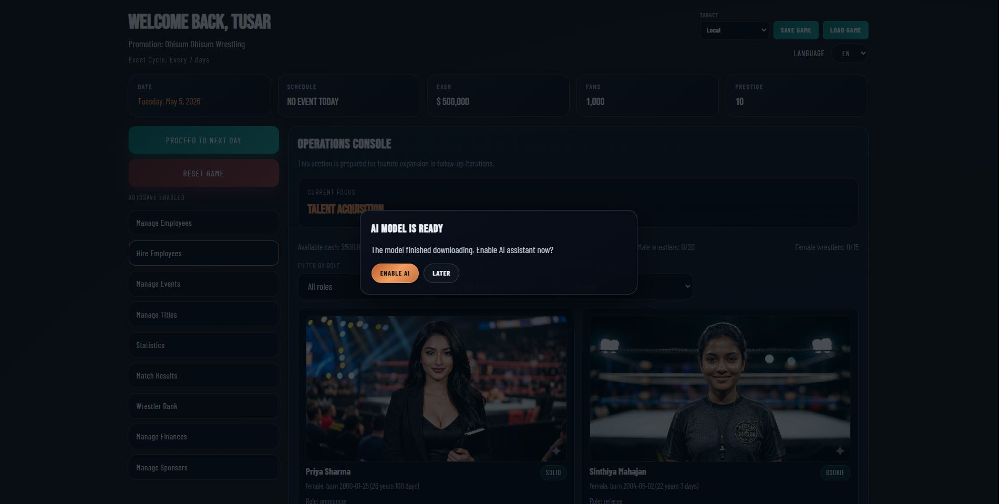
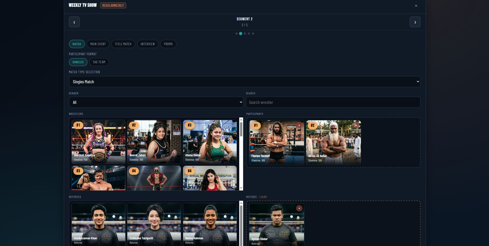
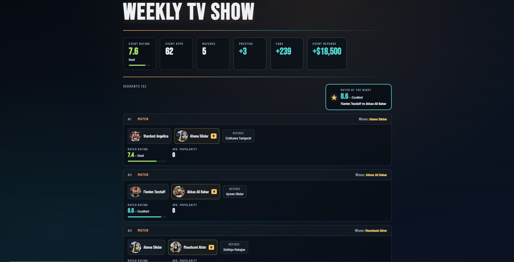
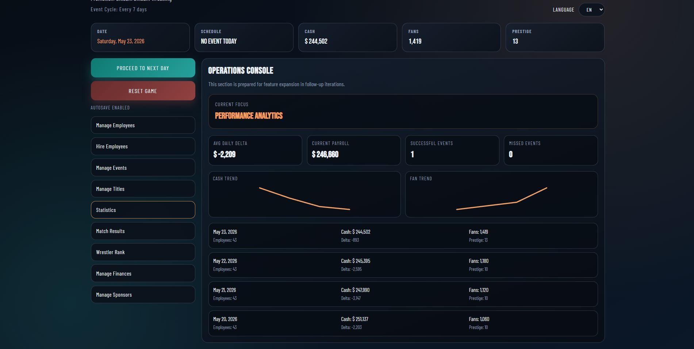
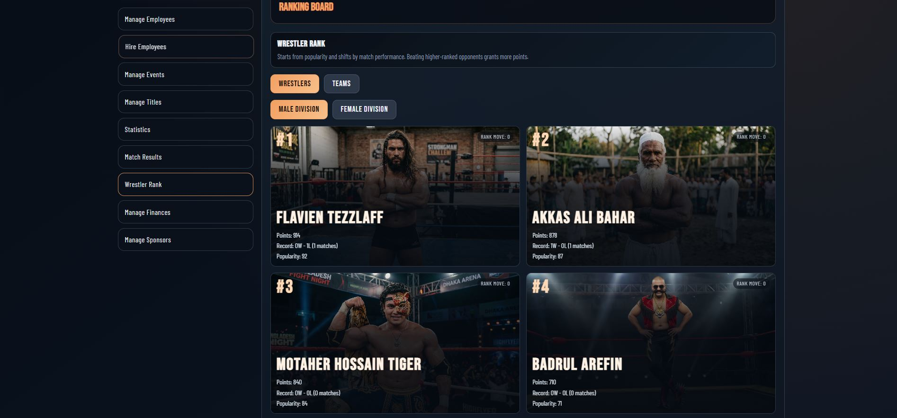
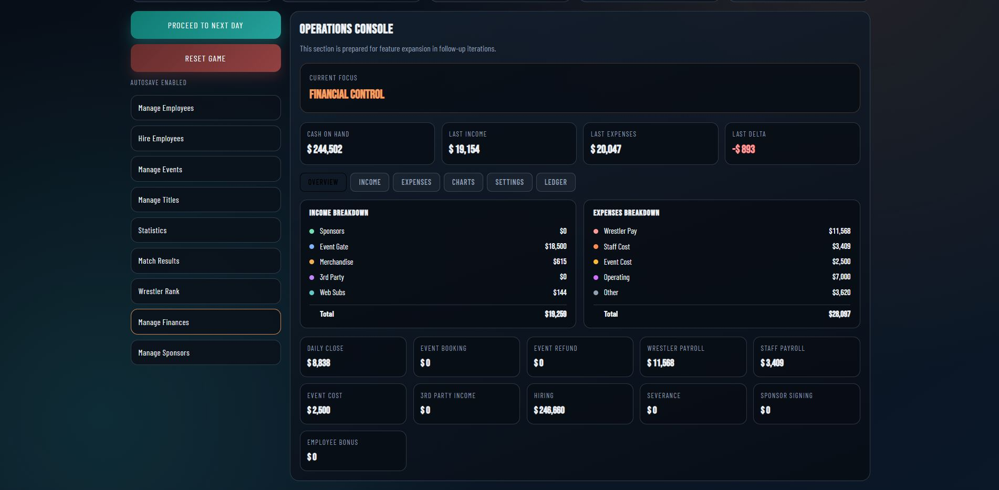
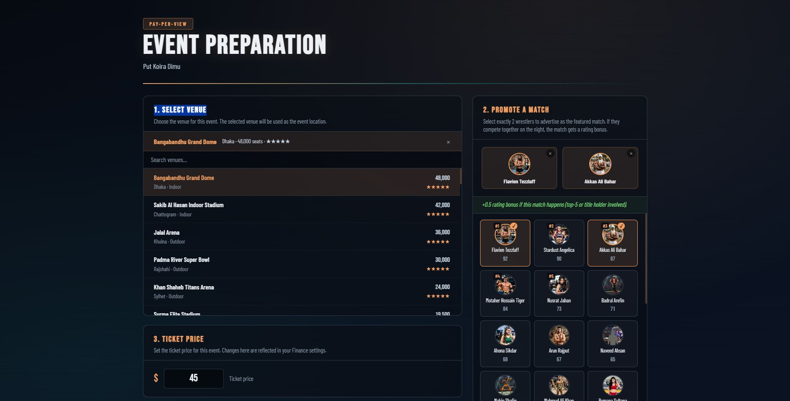

# 🎭 Wrestling Tycoon
<a href="https://youtu.be/O9Vce6h7eBY">
  
  <div>Watch Video Guide By Clicking on Image Above</div>
</a>


**Build your wrestling empire from the ground up!**

Wrestling Tycoon is a comprehensive sports management simulation game where you become the owner and operator of a wrestling company. Start with limited resources and grow your organization into a powerhouse by hiring talented wrestlers, booking matches, managing finances, and building your company's prestige and reputation.



---

## 📋 Table of Contents

- [Features](#-features)
- [Phase Updates](#-phase-updates)
- [Game Overview](#-game-overview)
- [Core Gameplay Systems](#-core-gameplay-systems)
- [Getting Started](#-getting-started)
- [Project Structure](#-project-structure)
- [Technologies](#-technologies-used)
- [Gameplay Guide](#-gameplay-guide)
- [System Documentation](#-system-documentation)

---

## ✨ Features

- **Dynamic Company Management**: Build and manage your wrestling organization from scratch
- **Roster Management**: Hire and manage wrestlers and staff with unique attributes
- **Event Creation**: Design custom wrestling events with various match types and segments
- **Financial System**: Track income, expenses, and cash flow throughout your company's growth
- **Prestige System**: Build your company's reputation through successful events and elite roster management
- **AI Integration**: Local AI-powered media interviews with gameplay consequences
- **Ranking System**: Dynamic wrestler ranking based on match performance and popularity
- **Happiness & Morale**: Manage employee satisfaction and team morale
- **Career Arcs**: Pursue eight-week objectives and unlock venues, promotional campaigns, promo formats, and event presentations
- **Competitor Intelligence**: Track rival promotions, talent poaching, counter-programming, and industry news
- **Board Governance**: Resolve monthly agendas, weighted votes, mandates, and annual elections
- **Mod Data Packages**: Import and export validated title, sponsor-offer, and event-template data
- **Multi-language Support**: Game available in multiple languages via i18n
- **Save/Load System**: Persistent game saves with cloud integration via Firebase

---

## 🚧 Phase Updates

### Phase 12 (2026-10-12)

- **Monthly Board Meetings**: Added a non-wrestling monthly meeting with an operating-period finance report and three agenda decisions.
- **Board Governance**: Added weighted votes, Relation, January officer elections, recovery mandates, and manager-dismissal outcomes.
- **Dashboard Integration**: Added the Board module, meeting room, member portraits, meeting history, mandate status, and next-meeting date.
- **Career Arc Unlocks**: Completed arcs now award new venues, featured-match campaigns, promo formats, and event-intro presentations.

### Phase 11 (2026-08-03)

- **Mod Data Pipeline (In-Game)**: Added JSON mod package export/import directly in the dashboard Save/Load controls.
- **Supported Modules**: Mod packages can now safely override Titles, Sponsor Offers, and Event Templates without editing source files manually.
- **Validation + Diagnostics**: Import now validates module shapes, removes duplicate IDs, skips malformed entries, and reports invalid package reasons.
- **Conflict-Safe Normalization**: Imported values are clamped/sanitized (tiers, trust, costs, multipliers, ratings) to prevent runtime breakage.
- **Creator Workflow Upgrade**: Players can export their live tuned data into a reusable mod package, edit externally, and re-import for rapid balancing.

### Phase 10 (2026-08-03)

- **Playable Onboarding Challenge**: New games begin with a 21-day rescue challenge covering roster building, one successful event, fan growth, and operating cash flow.
- **Objective Tracking**: The dashboard now shows live progress for roster building, first successful show, and early fan/cash stabilization goals.
- **Win/Fail Consequences**: Completing all objectives grants a meaningful cash and prestige reward; missing the deadline applies fan/prestige penalties.
- **Persistence and Save Support**: Challenge state is now merged and persisted safely so progress survives reloads and legacy saves.
- **Manual Save Snapshot Update**: Local/cloud save snapshots now include progression and onboarding challenge data for consistent restore behavior.

### Phase 9 (2026-08-03)

- **Better AI Competitor Companies**: Rival promotions now run a daily simulation loop with scouting, counter-programming, and poaching actions.
- **Talent Market Pressure**: Competitors can sign promising free-agent wrestlers from the market before you do, increasing talent-race pressure.
- **Poaching System**: Vulnerable low-happiness wrestlers are now at risk of being poached by rival companies, including visible world-news headlines.
- **Counter-Programming Layer**: Rival cards now create additional fan/prestige pressure beyond the base competitor swing model, especially on event nights.
- **Industry News Feed Expansion**: All competitor actions (counter-programming, signings, poaches) now stream into the existing Competitor Intel feed for world-state visibility.

### Phase 8 (2026-08-03)

- **Sponsor Reputation Layer 2.0**: Sponsors now react after every event to your card tone and outcomes using brand-safety, scandal pressure, family audience share, and star-power signals.
- **Brand-Fit Trust Dynamics**: Trust gains/losses are now influenced by sponsor brand fit (Tech/Media/Luxury/Community vs Combat/Entertainment/Performance/Lifestyle), not just generic performance.
- **High-Tier Sponsor Guardrails**: Tier 6-7 sponsors now require a recent event track record plus minimum brand-safety and family-audience profile before signing.
- **Sponsor Churn Risk**: Critically damaged high-tier relationships can now trigger sponsor exits, captured in ledger history.
- **Signing Feedback UX**: Sponsor offers now show explicit blocking reasons for high-tier brand-safety gates and failed sign attempts.

### Phase 7 (2026-08-03)

- **Contract + Morale Drama**: Low-happiness wrestlers and staff can now trigger time-limited salary demands; wrestlers can also request title shots.
- **Player Response Layer**: Manage Employees cards now surface active demands with approve/reject actions and immediate feedback.
- **Promise Consequences**: Accepting a title-shot demand creates a fulfillment deadline; delivering the title shot boosts morale while missing the promise causes a notable happiness penalty.
- **Walkout Risk Escalation**: Ignored/overdue demands now apply extra happiness pressure and can escalate into departures when morale collapses.
- **Retention Accounting**: Approved salary-demand payouts are now tracked in the ledger under a dedicated Employee Retention category.

### Phase 6 (2026-08-03)

- **Career Arc System**: Added a medium-term progression layer that auto-generates an 8-week Career Arc with fan, prestige, and cash growth objectives plus unlockable content rewards.
- **Arc Rewards & Fail States**: Completing an arc grants structured rewards (cash, prestige, sponsor trust), while missed goals mark the arc as failed and roll to a fresh objective.
- **Arc History Tracking**: Completed and failed arcs are now stored in recent history, making long-run campaign performance easier to review.
- **New Dashboard Module**: Added a dedicated Career Arc module showing active goals, progress bars, reward details, and recent arc outcomes.

### Phase 5 (2026-08-03)

- **Competitor Intelligence Module**: Added a new dashboard module that tracks competitor pressure history, highlights recent headlines, and summarizes average fan/prestige swings.
- **Country-Based Management Generation**: Onboarding now includes a Management Base Country selector that guides faker-user generated Owner and General Manager identities.
- **Competition Balance Knobs**: Competitor pressure is now configurable through `GAME_CONFIG.competition`, including rating baseline, swing scale, random range, rivalry scaling, event volatility, and prestige conversion limits.

### Phase 4 (2026-08-03)

- **Competitor Pressure System**: Event resolution now simulates a competing promotion each event night, creating momentum swings that can increase or reduce your fan gain.
- **Prestige Tug-of-War**: Rival company performance now applies a small prestige pressure modifier, making strong cards more important for maintaining brand momentum.
- **Competitor Explainability**: Event Results now includes a Competitor Pressure panel with headline context plus fan/prestige impact values.
- **Management Identity Generation**: New games now auto-generate Owner, General Manager, and Home Country profile metadata using faker-user.
- **Leadership Visibility**: Dashboard header and HUD now display leadership identity and latest competitor pressure snapshot for faster strategic reads.

### Phase 3 (2026-08-03)

- **Dynamic Audience Segments**: Event simulation now models four audience groups: Casual, Hardcore, Family, and Online.
- **Card Fit Matters**: Segment composition (promos, title matches, main events), match quality, event hype/risk, and rivalry heat now shape audience satisfaction per segment.
- **Audience-Driven Outcomes**: Segment mix now contributes to fan delta and event income through satisfaction and spend-profile adjustments.
- **Event Results Breakdown**: Event Results now includes an Audience Segments panel showing attendance share, satisfaction, and fan impact for each segment.

### Phase 2 (2026-08-03)

- **AI Interview Consequences**: Completed interviews now apply gameplay impact to fans and prestige based on answer quality and interview flow.
- **Sponsor Trust Reactions**: Sponsors now maintain a dynamic trust value (0–100) that shifts after interviews and reacts to your communication style.
- **Trust-Weighted Sponsor Value**: Sponsor payouts, fan boosts, and event multipliers are now weighted by sponsor trust, creating meaningful long-term relationship management.
- **Interview Impact Feedback**: End-of-interview impact summary is shown in the interview modal and includes fan, prestige, and sponsor trust changes.
- **Sponsor UI Upgrade**: Active sponsor cards now show trust and relationship status; offers show starting trust.

### Phase 1 (2026-08-03)

- **Rivalry Heat Engine**: Rivalries now accumulate heat through match interactions and decay over time.
- **Rivalry Outcome Influence**: High-heat rivalries can increase event fan growth and prestige momentum.
- **Event Postmortem**: Results now include a “Why This Happened” breakdown for fan, prestige, and money drivers.

---

## 🎮 Game Overview

### Starting Position
- **Initial Cash**: $500,000
- **Starting Fans**: 1,000
- **Initial Prestige**: 10
- **Event Cycle**: 7 days between major events

### Your Objectives

1. **Grow Your Fan Base**: Attract more fans through successful events and roster quality
2. **Build Prestige**: Establish your company as a major wrestling promotion
3. **Manage Finances**: Balance income and expenses to maintain profitability
4. **Develop Talent**: Hire wrestlers, manage their happiness, and build a championship roster
5. **Create Content**: Book engaging events with compelling match cards



---

## 🎯 Core Gameplay Systems

### 1. Financial System

Your company's lifeblood—manage cash carefully to survive and thrive.

#### Income Sources
- **Web Subscriptions**: Daily revenue based on fans, the subscription fee, and its configured subscriber rate
- **Sponsor Payouts**: Daily recurring revenue from non-event sponsors, weighted by sponsor trust
- **Merchandise**: Daily title-holder merchandise, plus eligible popular event participants
- **Third-Party Income**: A configured daily random chance
- **Event Revenue**: Gate receipts and event/audience adjustments when an event is actually run

#### Expenses
- **Monthly Payroll**: Contract salaries charged on 30-day contract anniversaries
- **Match Payroll**: Wrestler and staff appearance fees; active title holders can receive an additional match bonus
- **Operating Costs**: Configured base cost plus a prestige-based amount, reduced by active board cost relief
- **Other Daily Costs**: A random configured expense range
- **Event Production**: Type-specific production cost when an event runs; separate from its one-time booking setup fee
- **Severance**: Based on contract per-match salary and signing bonus, not a percentage of monthly salary

#### Key Mechanics
- Daily timeline cash updates compute income and expenses automatically
- Event booking requires upfront setup costs
- Deleting future events refunds 60% of setup costs
- All transactions tracked in ledger (last 120 entries)

There is no flat $18,000 daily base-income payment or fixed $5,500 staffing charge.  
**See**: [docs/FINANCE_MONEY_SYSTEM.md](docs/FINANCE_MONEY_SYSTEM.md) for current formulas and defaults.

### 2. Prestige System

Your company's reputation in the wrestling world—starts at 10, cannot fall below 0, and has no upper cap.

#### What Affects Prestige

**Event Performance** (Primary Driver)
- Event hype, risk, raw segment bonuses, wrestler popularity, and match ratings form an event score that is scaled before applying prestige.
- Rivalry heat and competitor performance add separate event-level prestige modifiers.
- Raw segment bonuses:
  - Match segment: +1
  - Main event: +4
  - Title match: +3
  - Promo: +1
  - Interview: 0

**Elite Roster**
- Hiring wrestler with skill ≥ 82: +1 to +7 prestige (scales with skill)
- Firing elite wrestler: -1 to -7 prestige (inverse of hire bonus)

**Event Skipping**
- Penalty: -5% to -10% of current prestige (minimum -1)
- The skipped event earns no gate or event-performance income; normal daily simulation income and expenses still occur when the timeline advances.

Prestige can also change through the daily competitor simulation, interviews, onboarding and career-arc outcomes, and approved board decisions. Elite wrestler hires and releases change prestige immediately.

**See**: [docs/prestige.md](docs/prestige.md) for detailed formulas



### 3. Happiness & Morale System

Keep your employees happy and productive.

#### Who Has Happiness
- **Wrestlers**: Tracked with happiness values (default: 50)
- **Staff**: Tracked with happiness values (default: 50)
- **Range**: Clamped between 0-100

#### Happiness Modifiers

**Match Outcomes (Wrestlers)**
- Win vs 1 opponent: +1
- Win vs multiple: +1 per opponent
- Loss vs 1 opponent: -2
- Loss vs multiple: -1

**Title Changes**
- Winning a title: +10 per title

**Inactivity**
- No matches for 30 days: -3 (once per 30-day period)

**Morale Demands**
- At happiness 22 or lower, wrestlers and staff may request a salary raise; wrestlers may request a title shot.
- Demands have a seven-day response window. Approved salary raises change contract costs; approved title-shot requests create a 21-day promise.
- Overdue demands reduce happiness and can lead to a walkout.

#### Critical Events
- **Termination**: Happiness reaches 0 → Employee leaves automatically
- **Rehire Lock**: Terminated employees locked from hiring for 90 days
- **Low Happiness Warning**: Alert modal for employees below 10 happiness

#### Bonus System
- Available in Manage Employees module
- Increases happiness based on employee rank and per-match salary
- Current title holders receive the title-holder bonus multiplier
- Minimum boost guaranteed at +1

**See**: [docs/HAPPINESS.md](docs/HAPPINESS.md) for bonus formulas

### 4. Ranking System

Track wrestler and team performance dynamically.

#### Wrestler Ranking

**Starting Points**
- Initial points = Popularity × 10
- Example: Popularity 67 → 670 starting points

**Point Changes Per Match**
- Winner gains points (upset bonus for beating higher-ranked opponents)
- Loser loses points (extra penalty for losing to lower-ranked opponents)
- Points clamped at minimum 0
- Upset factor scales with point difference: (loserPoints - winnerPoints) × 0.04
- Gain formula: clamp(6 + upsetFactor, 3, 24)

**Ranking Order**
1. Sort by rank points (highest first)
2. Tiebreaker: Popularity (highest)
3. Final tiebreaker: Name (A-Z)

**Rank Delta**: Displayed as movement from initial seed position to current position

#### Team Ranking

- Separate rankings for male and female divisions
- Mixed teams appear in both views
- Team points average members of the selected gender division
- Sorted by team points then team name

**See**: [docs/RANKING_POINTS.md](docs/RANKING_POINTS.md) for detailed calculations



### 5. Event System

Create and manage wrestling events with various formats.

#### Event Types
- **Regular Weekly**: Standard weekly shows
- **House Show**: Non-televised local events
- **Digital Only**: Online streaming events
- **PPV** (Pay-Per-View): Premium televised events
- **Mega Live**: Large-scale live events
- **One-Time**: Special one-time events
- **Custom Events**: Build your own event format

#### Event Components

**Segments** (Build your card)
- Match segments: Standard wrestling matches
- Main events: Primary attraction matches
- Title matches: Championship battles
- Promos: Wrestler interviews and character work
- Interviews: AI-powered or custom interview content

**Event Financial Impact**
- Gate revenue based on attendance
- Event expenses include production costs
- Per-match salaries for wrestler appearances
- Sponsor bonuses for supported event types

#### Event Hype & Requirements
- Event hype affects prestige gains
- Requirements determine event eligibility
- Event type and configured ranges determine production cost and attendance; template production-scale metadata is not currently used by the simulation

---

## 🚀 Getting Started

### Prerequisites
- Node.js 20.19+ or 22.12+ (required by the current Vite version)
- npm or yarn package manager

### Installation

1. **Clone the repository**
   ```bash
   cd WrestlingTycoon
   ```

2. **Install dependencies**
   ```bash
   npm install
   ```

3. **Set up environment variables**
   - Copy `.env.example` to `.env.local` (if available)
   - Configure Firebase credentials in `src/config/firebase.js`
   - Optional: Set game configuration via environment variables

4. **Start development server**
   ```bash
   npm run dev
   ```
   Game opens at `http://localhost:5173`

5. **Build for production**
   ```bash
   npm run build
   ```

6. **Preview production build**
   ```bash
   npm run preview
   ```

### Tests

```bash
npm test
npm run test:coverage
```

The coverage command enforces per-file 80% minimums for statements, lines, and functions on the configured JavaScript modules. Vitest does not instrument its active Vite configuration file.

### Game Configuration

Key settings in `src/config/gameConfig.js`:

| Setting | Default | Description |
|---------|---------|-------------|
| Starting Cash | $500,000 | Initial company funds |
| Starting Fans | 1,000 | Initial fan base |
| Starting Morale | 60 | Initial company morale |
| Event Cycle Days | 7 | Days between event windows |

---

## 📁 Project Structure

```
WrestlingTycoon/
├── public/                      # Static assets
│   ├── Belt/                   # Championship belt images
│   ├── Company/                # Company logos/branding
│   ├── Events/                 # Event promotional images
│   ├── people/                 # Character portraits (wrestlers, staff)
│   │   ├── wrestler/           # Wrestler images by gender
│   │   ├── manager/            # Manager portraits
│   │   ├── referee/            # Referee portraits
│   │   ├── announcer/          # Announcer portraits
│   │   └── staff/              # Staff portraits
│   └── Promo/                  # Marketing/promotional images
├── src/
│   ├── ai/                     # AI integration (WebLLM, interview system)
│   ├── app/                    # App routing and structure
│   ├── components/             # React components
│   │   ├── common/             # Shared components (language switcher, save/load)
│   │   ├── dashboard/          # Main dashboard UI
│   │   │   ├── BoardMeetingModal.jsx
│   │   │   └── modules/        # Game system modules
│   │   │       ├── BoardModule.jsx
│   │   │       ├── CareerArcModule.jsx
│   │   │       └── CompetitorIntelModule.jsx
│   │   └── onboarding/         # Game start experience
│   ├── config/                 # Configuration (Firebase, game settings)
│   ├── data/                   # Game data
│   │   ├── people/             # Character data files (JSON)
│   │   │   └── board.json      # Board member records
│   │   ├── board.js            # Board member roles and officers
│   │   ├── employeeMarket.js   # Hiring pool
│   │   ├── eventTemplates.js   # Event templates
│   │   ├── matchTypes.json     # Match type definitions
│   │   ├── sponsor.json        # Sponsorship data
│   │   ├── titles.json         # Championship titles
│   │   └── venue.json          # Venue information
│   ├── i18n/                   # Internationalization (i18next)
│   │   └── locales/            # Language files
│   ├── pages/                  # Page components
│   ├── saveGame/               # Save game files
│   ├── store/                  # State management (Zustand)
│   │   ├── useGameStore.js     # Main game state
│   │   └── selectors.js        # Store selectors
│   ├── styles/                 # Global styles (SCSS)
│   └── utils/                  # Utility functions
│       ├── boardMeetingAgendas.js
│       ├── boardMeetingSystem.js
│       ├── boardMeetings.js
│       ├── heelFaceMeter.js    # Alignment calculation
│       └── wrestlerRank.js    # Ranking calculations
├── docs/                       # Game documentation
│   ├── BOARD_MEETING_PLAN.md   # Board meeting flow and governance rules
│   ├── FINANCE_MONEY_SYSTEM.md # Financial system details
│   ├── HAPPINESS.md            # Happiness system details
│   ├── HEEL_FACE_SYSTEM.md     # Alignment and decay rules
│   ├── RANKING_POINTS.md       # Ranking calculation details
│   └── prestige.md             # Prestige system details
├── vite.config.js              # Vite configuration
├── eslint.config.js            # ESLint rules
└── package.json                # Project dependencies
```

---

## 💻 Technologies Used

### Frontend Framework
- **React 19.2.5**: UI components and state management
- **Vite 8.0+**: Build tool and development server
- **React Router 7**: Navigation and page routing

### State Management
- **Zustand 5**: Lightweight state management library
- **Selectors pattern**: Memoized state selectors for performance

### Styling
- **SCSS/Sass**: Modular component styling
- **CSS Modules**: Scoped styles for components

### Internationalization
- **i18next 26**: Multi-language support system
- **react-i18next**: React binding for i18n

### AI & ML
- **WebLLM 0.2.79**: Local AI model inference for media interviews

### Data & Backend
- **Firebase 12.12.1**: Cloud database and authentication
- **Firestore Rules**: Database access control

### Data Visualization
- **Recharts 3.8.1**: React charting library for statistics/analytics

### Development Tools
- **ESLint 10**: Code quality and style enforcement
- **Node.js**: Runtime environment

---

## 🎮 Gameplay Guide

### Getting Started (First Steps)

1. **Create Your Company**
   - Enter company name on start screen
   - Select your company name and customize initial preferences
   - Begin with $500,000 and 1,000 fans

2. **Build Your Roster**
   - Go to **Manage Employees** module
   - Browse available wrestlers in the hiring market
   - Hire wrestlers that fit your budget and skill level
   - Hire support staff (managers, referees, announcers)

3. **Book Your First Event**
   - Navigate to **Events** module
   - Create a custom event or accept a scheduled event
   - Select event type (Regular Weekly, House Show, etc.)
   - Build your match card by adding segments
   - Set event hype and requirements
   - Confirm event when ready

4. **Run the Event**
   - Follow timeline to event date
   - Match outcomes determined automatically based on wrestler skill
   - Event generates income based on attendance
   - Prestige updates based on event performance

### Day-to-Day Management

- **Daily Timeline**: Advance days to progress time; cash updates automatically
- **Monitor Finances**: Check daily income/expenses in Finance module
- **Track Prestige**: Watch your company reputation grow
- **Manage Happiness**: Address low employee happiness before they quit
- **Update Ranking**: Monitor wrestler performance and rankings
- **Board Governance**: Attend monthly meetings, manage mandates, and review the next scheduled meeting
- **Career Progression**: Track objectives and rewards in the Career Arc module
- **Competitor Intel**: Respond to rival promotion activity and talent-market pressure

### Advanced Strategies

- **Sponsorship Deals**: Secure sponsors for recurring daily income
- **Elite Roster Building**: Hire high-skill wrestlers (80+) for prestige boosts
- **Event Optimization**: Create high-hype events with popular wrestlers for prestige gains
- **Title Management**: Title wins improve wrestler happiness and contribute to event results
- **Staff Balance**: Include managers, referees, and announcers in event planning while managing their contract costs



---

## 📚 System Documentation

For detailed system specifications, see the docs folder:

- **[Financial System](docs/FINANCE_MONEY_SYSTEM.md)**: Complete income/expense calculations, daily timeline updates, sponsor flows, and ledger tracking
- **[Happiness System](docs/HAPPINESS.md)**: Employee satisfaction mechanics, bonus calculations, and termination rules
- **[Prestige System](docs/prestige.md)**: Company reputation formula, event impact, elite wrestler bonuses, and skipping penalties
- **[Ranking System](docs/RANKING_POINTS.md)**: Wrestler ranking points, match impact calculations, and team rankings
- **[Heel/Face System](docs/HEEL_FACE_SYSTEM.md)**: Alignment shifts, labels, and event-run decay
- **[Board Meeting System](docs/BOARD_MEETING_PLAN.md)**: Monthly finance review, agendas, votes, mandates, and dismissal rules

---

## 🎬 Gallery






---

## 📝 License

This project is proprietary. All rights reserved.

---

## 🤝 Contributing

This is a personal project. For suggestions or issues, please create an issue in the repository.

---

## 🎓 Learning Resources

The game integrates:
- **WebLLM for AI**: Local model inference without external API calls
- **Firebase for Backend**: Real-time database with secure rules
- **Zustand for State**: Lightweight, scalable state management
- **React Router for Navigation**: Modern client-side routing

Great for learning full-stack game development with React, state management patterns, and game simulation systems!

---

**Build your wrestling empire today! 🎭🏆**
